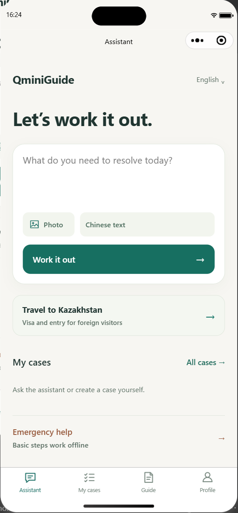
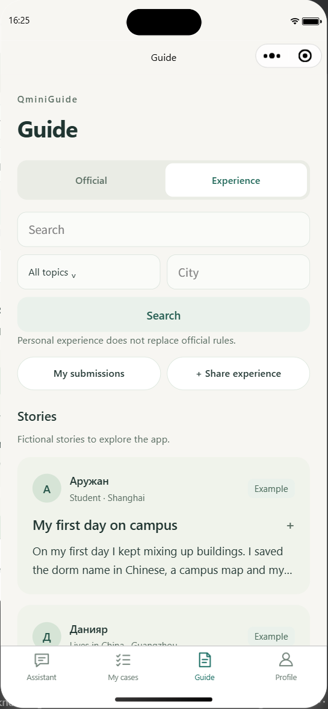
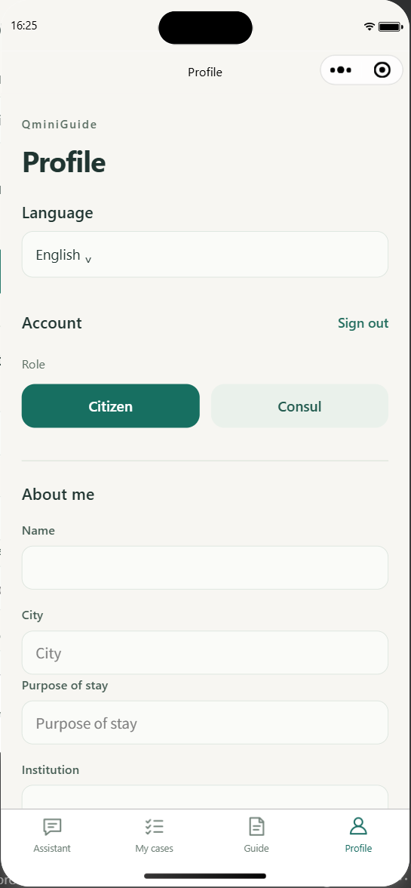

# QminiGuide

QminiGuide is a local demo of a WeChat Mini Program and FastAPI assistant for Kazakhstan citizens in China and visitors to Kazakhstan. It demonstrates multilingual chat, translation, document questions, saved cases and checklists, and citizen-consul requests.

Core libraries: [FastAPI](https://fastapi.tiangolo.com/), [Uvicorn](https://www.uvicorn.org/), [LangGraph](https://docs.langchain.com/oss/python/langgraph/overview), [Pydantic](https://docs.pydantic.dev/latest/), and [HTTPX](https://www.python-httpx.org/). Pinned dependencies are listed in `pyproject.toml` and `uv.lock`.

## Screenshots

Current interface captured in WeChat DevTools on 2026-10-28 with the local demo backend: the assistant home, community guide, and citizen profile. These screenshots show the UI; they are not an evaluation of model output.

| Assistant | Guide | Profile |
| --- | --- | --- |
|  |  |  |

## Run on Windows

Install [Python 3.12](https://docs.python.org/3.12/), then run these commands in PowerShell from the project folder. The setup uses [uv](https://docs.astral.sh/uv/):

```powershell
py -3.12 -m venv .venv
.\.venv\Scripts\python.exe -m pip install uv==0.13.4
.\.venv\Scripts\uv.exe sync --locked --extra dev
.\START_LOCAL_WORKSPACE.cmd --mock
```

Keep the backend window open. In WeChat DevTools, open `frontend/wechat-miniprogram` and compile the Mini Program. The local API listens on `127.0.0.1:8000`; press `Ctrl+C` in the backend window to stop it. `--mock` uses a mock AI provider. Photo OCR remains in manual/demo mode unless `--local-ocr` is enabled with Tesseract and its language data configured.

For local AI, start [Ollama](https://github.com/ollama/ollama) with `qwen3.5:9b-q4_K_M` installed, then run `START_LOCAL_WORKSPACE.cmd` without `--mock`. For photo recognition, install [Tesseract](https://github.com/tesseract-ocr/tesseract) and the `chi_sim`, `eng`, `rus`, and `kaz` language data. Pass `--local-ocr`, `--tesseract` with the executable path, and `--tessdata-dir` with the language-data folder. Models, OCR binaries, and language data are installed separately.

Bundled source snapshots are demonstration material and have not been independently reviewed. Check current travel and legal requirements with official sources. No public reuse license has been selected.

## Selected check results

Checks on the reduced 490-file source snapshot, 2026-10-28:

- **181 Python tests passed in 11.22 seconds**, covering account roles, local sign-in, chat routing, document integrity, consular documents, storage boundaries, and visa-rule conflicts.
- **Three frontend suites passed**, covering accounts, dialogue, and local demo authentication.
- Backend startup, source listing, four admin pages, and a mock chat response passed in an isolated copy containing only published files.
- A separate real-provider run completed Chinese-to-Kazakh translation and Russian message drafting, including the application's separate model-review request. Local Tesseract reproduced the synthetic Chinese image text exactly.

These are selected functional checks, not a comprehensive answer-quality evaluation. The latest performance run used HTTP endpoints; it did not repeat the full WeChat UI journey.

## Local performance

Measured on 2026-10-28 with Windows, Intel Core Ultra 9 275HX, 32 GB installed RAM (31.4 GiB available to Windows), and an NVIDIA RTX 5090 Laptop GPU with 24 GB VRAM. Runtime: Python 3.12.10, Ollama 0.40.6, `qwen3.5:9b-q4_K_M`, 8,192-token context, 1,200-token output limit, temperature 0, thinking disabled. OCR: Tesseract 5.5.3.

| Operation | Observed time | Sample |
| --- | ---: | --- |
| Backend process launch to successful `/health` | **1.58–1.63 s** | 3 starts; model loading is deferred until a request |
| First Chinese-to-Kazakh translation, model initially unloaded | **56.34 s** | 1 request, including generation and model review |
| Same translation with the model loaded | **2.52–2.53 s** | 2 requests, including generation and model review |
| First short Russian message draft, model initially unloaded | **53.31 s** | 1 conversational request, including generation and model review |
| Same message draft with the model loaded | **1.53 s** | 1 conversational request, including generation and model review |
| Local OCR through the photo-intake endpoint | **0.36 s** | 1 clean synthetic 1400 × 220 PNG; exact text match |

Translation and OCR input: `请携带护照和签证到派出所办理登记。` The dialogue task asked for a short, polite request to a neighbour to turn down music, using the Mini Program's `use_conversation_context=true` setting.

Times measure the complete loopback HTTP response, not time to first token or WeChat rendering. Requests ran sequentially; warm samples repeated the same input and may benefit from prompt caching. The model was absent from Ollama's loaded-model list before each first-request measurement; this was not a cold OS/disk-cache test. Longer documents, different hardware, concurrency, and camera-photo quality can change these results substantially. These small samples are not throughput or percentile benchmarks.
